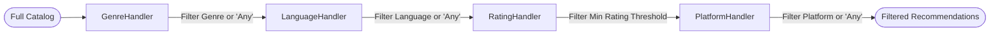
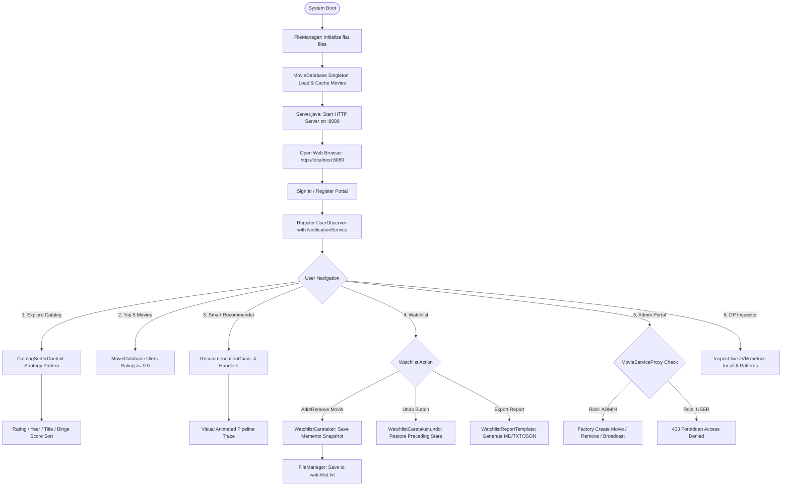

# 🎬 CinePattern — Movie & OTT Recommendation System

[-ED8B00?style=for-the-badge&logo=openjdk&logoColor=white)](https://www.java.com/)
[](https://en.wikipedia.org/wiki/Design_Patterns)
[](frontend/)
[](backend/data/)
[](https://github.com/sayyadrehan09/DP-Lab)

> **CinePattern (TiMN)** is a full-stack, enterprise-grade **Movie & OTT Recommendation System** engineered for the **Design Patterns Laboratory Assessment**. It features a high-performance native Java REST backend, flat-file persistence, and a modern dark obsidian / flame-cinnabar cinematic web interface (Pinwheel / Atlas Bento-Grid aesthetic).
>
> The system harmoniously implements **8 classic Gang of Four (GoF) design patterns** across Creational, Structural, and Behavioral categories, providing dynamic strategy-based catalog sorting, 4-stage sequential recommendation filtering, role-based protection proxies, decoupled real-time push notifications, a Memento-powered watchlist undo engine, and multi-format template report generation.

---

## 📑 Table of Contents

1. [🌟 Key Features](#-key-features)
   - [Regular User Features](#regular-user-features)
   - [Admin Features](#admin-features)
   - [System & Diagnostic Features](#system--diagnostic-features)
2. [📁 Directory & Folder Structure](#-directory--folder-structure)
3. [🛠 8 Gang of Four (GoF) Design Patterns Implemented](#-8-gang-of-four-gof-design-patterns-implemented)
   - [1. Singleton Pattern](#1-singleton-pattern-creational)
   - [2. Factory Method Pattern](#2-factory-method-pattern-creational)
   - [3. Protection Proxy Pattern](#3-protection-proxy-pattern-structural)
   - [4. Observer Pattern](#4-observer-pattern-behavioral)
   - [5. Chain of Responsibility Pattern](#5-chain-of-responsibility-pattern-behavioral)
   - [6. Strategy Pattern](#6-strategy-pattern-behavioral)
   - [7. Template Method Pattern](#7-template-method-pattern-behavioral)
   - [8. Memento Pattern](#8-memento-pattern-behavioral)
4. [📊 Design Patterns Summary Matrix](#-design-patterns-summary-matrix)
5. [🔄 System Architecture & Workflow](#-system-architecture--workflow)
6. [🌐 REST API Endpoints Reference](#-rest-api-endpoints-reference)
7. [💾 Data Storage Schema](#-data-storage-schema)
8. [🚀 Getting Started & How to Run on Localhost](#-getting-started--how-to-run-on-localhost)
   - [Option A: One-Click Windows Launcher (`start.bat`)](#option-a-one-click-windows-launcher-recommended)
   - [Option B: Manual Terminal Execution (Web Server on :8080)](#option-b-manual-terminal-execution-web-app)
   - [Option C: Interactive Terminal Console CLI (`Main.java`)](#option-c-interactive-terminal-console-cli)
   - [Option D: Running via IDE (IntelliJ IDEA / VS Code)](#option-d-running-via-ide-intellij-idea--vs-code)
9. [🎓 Lab Viva Defense & Design Trade-offs](#-lab-viva-defense--design-trade-offs)
10. [👨‍💻 Author & Credits](#-author--credits)

---

## 🌟 Key Features

### Regular User Features
* **Catalog Exploration & Strategy Sorting:** Explore over 40 curated titles across genres (Sci-Fi, Action, Drama, Comedy, Thriller) and platforms (Netflix, Prime Video, Disney+). Dynamically sort the catalog at runtime by **IMDb Rating**, **Release Year**, **Alphabetical Title (A–Z)**, or compound **Binge Score**.
* **Curated Top 5 Masterpieces:** Instant access to cinema masterworks with ratings $\ge 9.0$ from the synchronized in-memory database.
* **4-Stage Smart Recommender:** Custom sequential filtering pipeline (`Genre -> Language -> Rating -> Platform`) with visual step-by-step candidate count elimination.
* **Personalized Watchlist with Instant Memento Undo:** Save and remove movies with persistent flat-file backing. Includes a dedicated **Undo** rollback mechanism to revert accidental deletions or additions.
* **Multi-Format Watchlist Export:** Export personal watchlists as **GitHub Markdown Tables**, **Monospaced ASCII Receipts**, or **Structured JSON** with instant copy-to-clipboard.
* **Live Notifications Drawer:** Real-time push alert feed triggered whenever an admin adds new titles or issues system announcements.
* **Social Activity & Parties:** Mock friends feed and watch party launcher for modern streaming immersion.

### Admin Features
* **Role-Based Protection Proxy:** Sensitive administrative endpoints are intercepted and verified via `MovieServiceProxy`. Unauthorized regular users are blocked with HTTP `403 Forbidden` / `Access Denied`.
* **Catalog Management:** Add new movies (instantiated through `MovieFactory` and verified by `MovieServiceProxy`) and delete movies with immediate disk synchronization.
* **System Broadcasts:** Publish announcements across the entire system, automatically delivered to all registered `UserObserver` subscribers.
* **Observer Roster Inspection:** Inspect all active user sessions currently subscribed to the notification system.

### System & Diagnostic Features
* **Interactive DP Inspector:** Real-time in-app dashboard displaying live metrics for all 8 GoF patterns inside the running JVM (e.g., Singleton instance address, observer subscriber count, chain pipeline steps, memento stack depth, active sorting strategy).
* **Dual Execution Mode:** Run as a full-stack Web Application (`Server.java` + browser on `http://localhost:8080`) or as a standalone interactive Terminal CLI (`Main.java`).
* **Zero External Dependencies:** Built purely on native Java standard libraries (`com.sun.net.httpserver`, `java.nio`, `java.util`) without heavy third-party framework overhead.

---

## 📁 Directory & Folder Structure

```plaintext
DP-Lab/
├── backend/                             # Core Java Engine & REST Web Server
│   ├── data/                            # Persistent flat-file storage
│   │   ├── movies.txt                   # Pipe-delimited movie catalog dataset
│   │   ├── users.txt                    # Registered user accounts & roles (USER/ADMIN)
│   │   └── watchlist.txt                # User-specific saved movie watchlists
│   ├── FileManager.java                 # File I/O persistence handler (load, save, sync)
│   ├── Main.java                        # Standalone interactive terminal console controller
│   ├── Movie.java                       # Movie domain entity model
│   ├── MovieDatabase.java               # [Creational] Singleton in-memory repository
│   ├── MovieFactory.java                # [Creational] Factory Method instantiation & parser
│   ├── ObserverPattern.java             # [Behavioral] Observer publish-subscribe engine
│   ├── ProxyPattern.java                # [Structural] Protection Proxy RBAC security gate
│   ├── RecommendationChain.java         # [Behavioral] Chain of Resp. 4-stage filter
│   ├── SortingStrategy.java             # [Behavioral] Strategy pattern catalog sorter
│   ├── WatchlistReportTemplate.java     # [Behavioral] Template Method multi-format export
│   ├── WatchlistMemento.java            # [Behavioral] Memento state snapshot & Caretaker stack
│   ├── Server.java                      # Built-in multi-threaded HTTP server & 14 REST routes
│   └── run-backend.bat                  # Backend launch batch script with JDK auto-detection
│
├── frontend/                            # Modern Dark Bento-Grid Single Page Web App
│   ├── index.html                       # SPA markup with 6 view panels & interactive modals
│   ├── style.css                        # Obsidian charcoal & flame cinnabar design tokens
│   ├── app.js                           # State manager, REST API client & pipeline animator
│   ├── supabase.js                      # Optional Supabase cloud synchronization client
│   └── images/                          # Movie posters, backdrops, and avatar assets
│
├── .gitignore                           # Git ignore rules for Java bytecode & IDE files
├── README.md                            # Comprehensive project documentation
└── start.bat                            # One-click Windows launcher (compiles & launches browser)
```

---

## 🛠 8 Gang of Four (GoF) Design Patterns Implemented

```
┌────────────────────────────────────────────────────────────────────────┐
│                        8 GOF DESIGN PATTERNS                           │
├─────────────────┬──────────────────────┬───────────────────────────────┤
│   Creational    │      Structural      │          Behavioral           │
├─────────────────┼──────────────────────┼───────────────────────────────┤
│ • Singleton     │ • Protection Proxy   │ • Observer Pattern            │
│ • Factory Method│                      │ • Chain of Responsibility     │
│                 │                      │ • Strategy Pattern            │
│                 │                      │ • Template Method Pattern     │
│                 │                      │ • Memento Pattern             │
└─────────────────┴──────────────────────┴───────────────────────────────┘
```

---

### 1. Singleton Pattern (Creational)
* **Source File:** [`backend/MovieDatabase.java`](backend/MovieDatabase.java)
* **Primary Class:** `MovieDatabase`
* **Problem Solved:** Prevents multiple uncoordinated copies of the movie database in memory across concurrent HTTP handler threads, avoiding data inconsistencies and wasted heap space.
* **Implementation Details:**
  * Private constructor `private MovieDatabase()` prevents direct instantiation from outside.
  * Thread-safe static accessor `public static synchronized MovieDatabase getInstance()`.
  * Centralizes all catalog queries, filters Top 5 movies ($\ge 9.0$), and coordinates synchronization with [`FileManager.java`](backend/FileManager.java).

```java
public class MovieDatabase {
    private static MovieDatabase instance;
    private List<Movie> movies;

    private MovieDatabase() {
        movies = new ArrayList<>();
    }

    public static synchronized MovieDatabase getInstance() {
        if (instance == null) {
            instance = new MovieDatabase();
        }
        return instance;
    }
}
```

---

### 2. Factory Method Pattern (Creational)
* **Source File:** [`backend/MovieFactory.java`](backend/MovieFactory.java)
* **Primary Class:** `MovieFactory`
* **Problem Solved:** Decouples domain object construction from data format parsing, centralizing validation and shielding the application from corrupted records or schema changes.
* **Implementation Details:**
  * `createMovie(...)`: Validates parameters (rating within $0.0-10.0$, positive year, non-empty title) and creates domain instances.
  * `createMovieFromFile(String line)`: Safely parses pipe-delimited text (`id|title|genre|language|rating|year|platform`), handling token extraction and data conversions.

```java
public class MovieFactory {
    public static Movie createMovie(int id, String title, String genre, String language, double rating, int year, String platform) {
        return new Movie(id, title, genre, language, rating, year, platform);
    }

    public static Movie createMovieFromFile(String data) {
        String[] parts = data.split("\\|", -1);
        if (parts.length != 7) return null;
        return new Movie(Integer.parseInt(parts[0]), parts[1], parts[2], parts[3],
                         Double.parseDouble(parts[4]), Integer.parseInt(parts[5]), parts[6]);
    }
}
```

---

### 3. Protection Proxy Pattern (Structural)
* **Source File:** [`backend/ProxyPattern.java`](backend/ProxyPattern.java)
* **Primary Classes:** `MovieService` (Interface), `RealMovieService` (Real Subject), `MovieServiceProxy` (Proxy)
* **Problem Solved:** Protects sensitive catalog modifications (adding movies, deleting movies, broadcasting announcements) using Role-Based Access Control (RBAC) without mixing security logic into domain models.
* **Implementation Details:**
  * Both `RealMovieService` and `MovieServiceProxy` implement the `MovieService` interface.
  * When `addMovie()` or `removeMovie()` is invoked, `MovieServiceProxy` inspects the user's role (`ADMIN` vs `USER`).
  * If the caller is an `ADMIN`, the proxy forwards the request to `RealMovieService`. If the caller is a `USER`, the proxy blocks the operation immediately and returns an `Access Denied` error (HTTP 403 Forbidden).


---

### 4. Observer Pattern (Behavioral)
* **Source File:** [`backend/ObserverPattern.java`](backend/ObserverPattern.java)
* **Primary Classes:** `Subject` (Interface), `Observer` (Interface), `NotificationService` (Concrete Subject), `UserObserver` (Concrete Observer)
* **Problem Solved:** Establishes a loosely coupled one-to-many publish-subscribe communication channel between event producers (admin actions, catalog updates) and event consumers (logged-in user sessions).
* **Implementation Details:**
  * `NotificationService` maintains an active subscriber registry `List<Observer>` and notification history.
  * When a user logs in (`POST /api/login`), a `UserObserver` is registered.
  * When a new movie is added or a broadcast is sent, `notifyObservers(message)` pushes notifications with timestamps and unique IDs to all active subscribers.

```java
public class NotificationService implements Subject {
    private List<Observer> observers = new ArrayList<>();
    private List<NotificationRecord> history = new ArrayList<>();

    public void addObserver(Observer observer) { observers.add(observer); }
    public void removeObserver(Observer observer) { observers.remove(observer); }
    public void notifyObservers(String message) {
        history.add(new NotificationRecord(message));
        for (Observer o : observers) {
            o.update(message);
        }
    }
}
```

---

### 5. Chain of Responsibility Pattern (Behavioral)
* **Source File:** [`backend/RecommendationChain.java`](backend/RecommendationChain.java)
* **Primary Classes:** `RecommendationHandler` (Abstract Handler), `GenreHandler`, `LanguageHandler`, `RatingHandler`, `PlatformHandler`, `RecommendationChain`
* **Problem Solved:** Avoids deeply nested conditional structures when filtering movies by multiple criteria. Handlers can be dynamically added, removed, or reordered without modifying existing filtering code.
* **Implementation Details:**
  * Forms a sequential processing pipeline:
    $$\text{All Movies} \xrightarrow{\quad} \text{GenreHandler} \xrightarrow{\quad} \text{LanguageHandler} \xrightarrow{\quad} \text{RatingHandler} \xrightarrow{\quad} \text{PlatformHandler} \xrightarrow{\quad} \text{Recommendations}$$
  * Implements `filterWithTrace()`: Each handler captures input count, applied criteria, and output count (`ChainTraceStep`), returning an execution trace displayed in the frontend animation.



---

### 6. Strategy Pattern (Behavioral)
* **Source File:** [`backend/SortingStrategy.java`](backend/SortingStrategy.java)
* **Primary Classes:** `MovieSortStrategy` (Interface), `CatalogSorterContext` (Context), and 4 Concrete Strategies:
  1. `RatingSortStrategy`: Sorts descending by IMDb score ($\text{Rating} \downarrow$).
  2. `YearSortStrategy`: Sorts newest release year first ($\text{Year} \downarrow$).
  3. `TitleSortStrategy`: Alphabetical order ($A \rightarrow Z$).
  4. `PopularitySortStrategy`: Composite binge score formula: $(\text{Rating} \times 10) + ((\text{Year} - 1970) \times 0.15)$.
* **Problem Solved:** Enables dynamic swapping of sorting algorithms at runtime through the UI or `GET /api/sort?by=...` without giant switch-case blocks or modifying catalog controllers.

```java
public interface MovieSortStrategy {
    List<Movie> sort(List<Movie> movies);
    String getStrategyName();
    String getDescription();
}

public class CatalogSorterContext {
    private MovieSortStrategy strategy;
    public CatalogSorterContext(MovieSortStrategy strategy) { this.strategy = strategy; }
    public void setStrategy(MovieSortStrategy strategy) { this.strategy = strategy; }
    public List<Movie> executeSort(List<Movie> movies) { return strategy.sort(movies); }
}
```

---

### 7. Template Method Pattern (Behavioral)
* **Source File:** [`backend/WatchlistReportTemplate.java`](backend/WatchlistReportTemplate.java)
* **Primary Classes:** `WatchlistReportTemplate` (Abstract Class), `MarkdownWatchlistReport`, `PlainTextWatchlistReport`, `JsonWatchlistReport`
* **Problem Solved:** Watchlist export across multiple formats requires an identical sequential algorithm (Header $\rightarrow$ Movie Rows $\rightarrow$ Summary Footer $\rightarrow$ Metrics Calculation) with distinct output syntaxes.
* **Implementation Details:**
  * Defines the invariant skeleton method `public final String generateReport(String username, List<Movie> movies)`. Subclasses cannot alter the algorithm sequence.
  * Subclasses implement format-specific primitive hooks: `formatHeader()`, `formatMovieRow()`, `formatFooter()`, `formatEmptyState()`.
  * Common helper `computeAverageRating()` is shared across all generators.

```java
public abstract class WatchlistReportTemplate {
    // Template Method: algorithm skeleton is invariant
    public final String generateReport(String username, List<Movie> movies) {
        StringBuilder sb = new StringBuilder();
        sb.append(formatHeader(username));
        if (movies == null || movies.isEmpty()) {
            sb.append(formatEmptyState());
        } else {
            for (int i = 0; i < movies.size(); i++) {
                sb.append(formatMovieRow(movies.get(i), i + 1));
            }
        }
        sb.append(formatFooter((movies != null) ? movies.size() : 0, computeAverageRating(movies)));
        return sb.toString();
    }

    protected abstract String formatHeader(String username);
    protected abstract String formatMovieRow(Movie movie, int index);
    protected abstract String formatFooter(int count, double avgRating);
    protected abstract String formatEmptyState();
}
```

---

### 8. Memento Pattern (Behavioral)
* **Source File:** [`backend/WatchlistMemento.java`](backend/WatchlistMemento.java)
* **Primary Classes:** `WatchlistMemento` (Memento), `WatchlistCaretaker` (Caretaker)
* **Problem Solved:** Allows users to undo accidental additions or removals from their watchlist without exposing private fields or violating encapsulation.
* **Implementation Details:**
  * `WatchlistMemento`: Immutable snapshot capturing the list of movie IDs, timestamp, and action description.
  * `WatchlistCaretaker`: Maintains an undo history stack `Stack<WatchlistMemento>` per user, capped at 20 states to prevent memory leaks.
  * When the user clicks **Undo**, `WatchlistCaretaker.undo(username)` pops the preceding state, and [`FileManager.java`](backend/FileManager.java) writes the restored state to disk.

```java
public class WatchlistMemento {
    private final List<Integer> movieIds;
    private final String timestamp;
    private final String description;

    public WatchlistMemento(List<Integer> ids, String desc) {
        this.movieIds = new ArrayList<>(ids); // Deep copy of state
        this.description = desc;
        this.timestamp = new SimpleDateFormat("HH:mm:ss").format(new Date());
    }
    public List<Integer> getSavedState() { return new ArrayList<>(movieIds); }
}

class WatchlistCaretaker {
    private static final Map<String, Stack<WatchlistMemento>> histories = new HashMap<>();
    public static void saveSnapshot(String user, List<Integer> ids, String desc) { ... }
    public static WatchlistMemento undo(String user) { ... }
}
```

---

## 📊 Design Patterns Summary Matrix

| # | Pattern | Category | Source File | Key Classes | Practical Role in System |
|:---:|:---|:---:|:---|:---|:---|
| **01** | **Singleton** | Creational | [`MovieDatabase.java`](backend/MovieDatabase.java) | `MovieDatabase` | Single synchronized in-memory movie repository across all threads. |
| **02** | **Factory Method** | Creational | [`MovieFactory.java`](backend/MovieFactory.java) | `MovieFactory` | Centralized creation and pipe-separated file parsing of `Movie` objects. |
| **03** | **Protection Proxy** | Structural | [`ProxyPattern.java`](backend/ProxyPattern.java) | `MovieServiceProxy`, `RealMovieService` | Role-based gate blocking unauthorized regular users from modifying catalog. |
| **04** | **Observer** | Behavioral | [`ObserverPattern.java`](backend/ObserverPattern.java) | `NotificationService`, `UserObserver` | Decoupled publish-subscribe notifying active users of new movies and alerts. |
| **05** | **Chain of Responsibility** | Behavioral | [`RecommendationChain.java`](backend/RecommendationChain.java) | `RecommendationChain`, `GenreHandler`, etc. | Sequential 4-stage filtering pipeline for smart recommendations. |
| **06** | **Strategy** | Behavioral | [`SortingStrategy.java`](backend/SortingStrategy.java) | `MovieSortStrategy`, `CatalogSorterContext` | Runtime interchangeable catalog sorting (Rating, Year, Title, Binge Score). |
| **07** | **Template Method** | Behavioral | [`WatchlistReportTemplate.java`](backend/WatchlistReportTemplate.java) | `WatchlistReportTemplate`, `MarkdownWatchlistReport` | Invariant report generation skeleton deferring formatting to subclasses. |
| **08** | **Memento** | Behavioral | [`WatchlistMemento.java`](backend/WatchlistMemento.java) | `WatchlistMemento`, `WatchlistCaretaker` | Immutable watchlist state snapshots enabling instant one-click Undo rollback. |

---

## 🔄 System Architecture & Workflow



---

## 🌐 REST API Endpoints Reference

| HTTP Method | Route | Description | Pattern Utilized |
|:---:|:---|:---|:---:|
| `GET` | `/api/movies` | Fetch all movies or filter by `?search=`, `?genre=`, `?platform=` | **Singleton** |
| `POST` | `/api/movies` | Add new movie with title, genre, rating, platform | **Factory Method** & **Proxy** |
| `DELETE` | `/api/movies?id={id}` | Delete a movie by ID | **Protection Proxy** |
| `GET` | `/api/top-movies` | Curated movies with rating $\ge 9.0$ | **Singleton** |
| `GET` | `/api/sort?by={rating\|year\|title\|popularity}` | Dynamically sorts catalog using selected strategy | **Strategy Pattern** |
| `POST` | `/api/recommend` | Runs 4-stage pipeline filter with execution trace | **Chain of Responsibility** |
| `GET` | `/api/watchlist?user={name}` | Retrieves personal saved movies for user | Flat-File Persistence |
| `POST` | `/api/watchlist` | Saves movie to watchlist with pre-mutation snapshot | **Memento Pattern** |
| `DELETE` | `/api/watchlist?user={name}&movieId={id}` | Removes movie with pre-mutation snapshot | **Memento Pattern** |
| `POST` | `/api/watchlist/undo` | Rolls back watchlist to preceding Memento snapshot | **Memento Pattern** |
| `GET` | `/api/watchlist/export?user={name}&format={md\|text\|json}` | Generates formatted report via Template Method | **Template Method** |
| `POST` | `/api/login` | Sign in or register as USER or ADMIN | **Observer Pattern** |
| `GET` | `/api/notifications` | Returns feed of broadcast messages | **Observer Pattern** |
| `POST` | `/api/notify` | Broadcast message to all subscribers (Admin only) | **Observer Pattern** & **Proxy** |
| `GET` | `/api/design-patterns` | Returns real-time metrics for all 8 GoF patterns | **All 8 Patterns** |

---

## 💾 Data Storage Schema

All persistent data is stored in the [`backend/data/`](backend/data/) directory using pipe (`|`) delimited flat text files:

### 1. `backend/data/movies.txt`
Stores the central movie catalog:
```plaintext
id|title|genre|language|rating|year|platform
1|The Shawshank Redemption|Drama|English|9.3|1994|Netflix
2|The Godfather|Drama|English|9.2|1972|Prime Video
3|The Dark Knight|Action|English|9.1|2008|Netflix
4|The Lord of the Rings|Action|English|9.0|2003|Prime Video
5|Inception|Sci-Fi|English|9.0|2010|Netflix
```

### 2. `backend/data/users.txt`
Stores registered user credentials and security roles:
```plaintext
username|role
Aryan|USER
Rehan|ADMIN
Sarah|USER
John Doe|USER
```

### 3. `backend/data/watchlist.txt`
Stores user-specific saved watchlist entries:
```plaintext
username|movieId|title|genre|language|rating|year|platform
Aryan|1|The Shawshank Redemption|Drama|English|9.3|1994|Netflix
Aryan|5|Inception|Sci-Fi|English|9.0|2010|Netflix
```

---

## 🚀 Getting Started & How to Run on Localhost

### Prerequisites
- **Java Development Kit (JDK)**: JDK 8 or higher (e.g., OpenJDK 24, Oracle JDK 17/21).
- A modern web browser (Google Chrome, Microsoft Edge, Mozilla Firefox, Brave, Safari).

---

### Option A: One-Click Windows Launcher (Recommended)
1. Navigate to the project root and double-click:
   ```cmd
   start.bat
   ```
2. The script will automatically:
   - Detect `javac` in your system `PATH`, `JAVA_HOME`, or IntelliJ's OpenJDK directory (`%USERPROFILE%\.jdks\openjdk-24`).
   - Compile all Java source files into `backend/bin/`.
   - Start the HTTP REST server on port `8080`.
   - Launch your default web browser to:
     ```
     http://localhost:8080
     ```

---

### Option B: Manual Terminal Execution (Web App)
1. Open PowerShell or Command Prompt and navigate to the backend directory:
   ```powershell
   cd backend
   ```
2. Compile all backend sources:
   ```powershell
   if (!(Test-Path bin)) { New-Item -ItemType Directory -Path bin }
   javac -d bin *.java
   ```
   *(Note: If `javac` is not in your global PATH, run using your JDK path, e.g.: `& "$env:USERPROFILE\.jdks\openjdk-24\bin\javac.exe" -d bin *.java`)*

3. Start the Java REST Server:
   ```powershell
   java -cp bin Server
   ```
4. Open your web browser and visit:
   ```
   http://localhost:8080
   ```

---

### Option C: Interactive Terminal Console CLI
To run the original command-line interface mode:
```powershell
cd backend
javac -d bin *.java
java -cp bin Main
```

---

### Option D: Running via IDE (IntelliJ IDEA / VS Code)
1. Open the `DP-Lab` folder in **IntelliJ IDEA** or **VS Code**.
2. Set the Project SDK to **Java 8+** (e.g., `openjdk-24`).
3. Locate [`backend/Server.java`](backend/Server.java), right-click, and select **Run 'Server.main()'**.
4. Open your browser and go to `http://localhost:8080`.

---

## 🎓 Lab Viva Defense & Design Trade-offs

| Question | Evaluation Focus | Technical Defense |
|:---|:---|:---|
| **Why use Protection Proxy over simple `if` checks in controllers?** | Single Responsibility & Decoupling | Keeps business logic clean; access rules can change or migrate to OAuth/JWT without touching the core `MovieDatabase`. |
| **How does Memento protect encapsulation?** | Information Hiding | The `WatchlistCaretaker` stores state snapshots on a stack but cannot inspect or modify their private fields, preserving data integrity. |
| **Strategy vs Chain of Responsibility?** | Behavioral Pattern Nuance | **Strategy** picks *one* mutually exclusive algorithm at runtime; **Chain of Responsibility** passes a request through *multiple* sequential filters in a pipeline. |
| **Why is `generateReport()` declared `final` in Template Method?** | Invariant Skeleton Protection | Prevents subclasses from altering the required sequence of steps (Header $\rightarrow$ Rows $\rightarrow$ Footer), while allowing them to customize formatting hooks. |
| **How does Singleton maintain thread safety?** | Concurrency in Java | `getInstance()` is declared `synchronized`, ensuring only one instance is created in JVM memory even under concurrent HTTP requests. |

---

## 👨‍💻 Author & Credits

* **Developer:** [Rehan Sayyad](https://github.com/sayyadrehan09)
* **GitHub Repository:** [sayyadrehan09/DP-Lab](https://github.com/sayyadrehan09/DP-Lab)
* **Course:** Design Patterns Laboratory (5th Semester)
* **Status:** Verified, Fully Operational on `http://localhost:8080`
