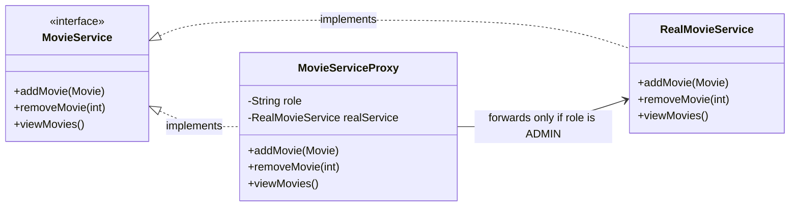
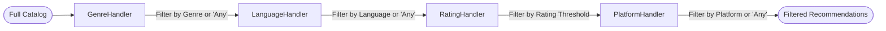
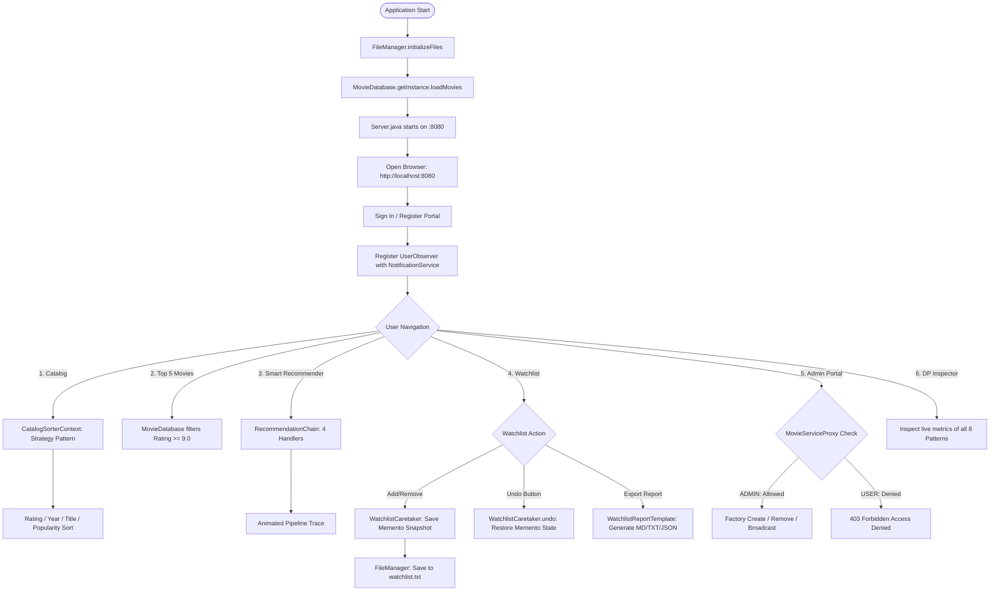

# 🎬 Movie & OTT Recommendation System (CinePattern)

[](https://www.java.com/)
[](https://en.wikipedia.org/wiki/Design_Patterns)
[](frontend/)
[-success?style=for-the-badge)](backend/data/)
[](https://github.com/sayyadrehan09/DP-Lab)

A full-stack, enterprise-grade **Movie & OTT Recommendation System** featuring a high-performance Java backend and a modern dark obsidian / flame-orange cinematic web interface (Pinwheel / Atlas Bento-Grid aesthetic).

Built for the **Design Patterns Laboratory Assessment**, this application demonstrates **8 classic Gang of Four (GoF) design patterns** working harmoniously across Creational, Structural, and Behavioral categories. It enables multi-criteria filtering, dynamic strategy-based sorting, personalized watchlists with Memento undo rollback, multi-format template report generation, and role-based protection proxies.

---

## 📑 Table of Contents

- [Key Features](#-key-features)
  - [Regular User](#regular-user)
  - [Admin](#admin)
- [Directory & Folder Structure](#-directory--folder-structure)
- [Design Patterns Implemented (8 Patterns)](#-design-patterns-implemented-8-patterns)
  - [1. Singleton Pattern](#1-singleton-pattern)
  - [2. Factory Method Pattern](#2-factory-method-pattern)
  - [3. Protection Proxy Pattern](#3-protection-proxy-pattern)
  - [4. Observer Pattern](#4-observer-pattern)
  - [5. Chain of Responsibility Pattern](#5-chain-of-responsibility-pattern)
  - [6. Strategy Pattern](#6-strategy-pattern-new)
  - [7. Template Method Pattern](#7-template-method-pattern-new)
  - [8. Memento Pattern](#8-memento-pattern-new)
- [Design Patterns Summary Matrix](#-design-patterns-summary-matrix)
- [System Architecture & Workflow](#-system-architecture--workflow)
- [REST API Endpoints Reference](#-rest-api-endpoints-reference)
- [Data Storage Schema](#-data-storage-schema)
- [Getting Started & How to Run](#-getting-started--how-to-run)
  - [Option A: Web Application (Full-Stack UI + REST Backend)](#option-a-web-application-recommended)
  - [Option B: One-Click Windows Launcher (`start.bat`)](#option-b-one-click-windows-launcher)
  - [Option C: Original Terminal CLI (`Main.java`)](#option-c-terminal-cli-console-mode)
- [Author & Credits](#-author--credits)

---

## 🌟 Key Features

### Regular User
- **Explore Catalog with Strategy Sorting:** Browse, search by title/genre/platform, and dynamically sort movies using runtime strategies (IMDb rating, release year, alphabetical A–Z, or binge score).
- **View Top 5 Masterpieces:** Instant access to curated cinema with scores $\ge 9.0$ from the Singleton database.
- **Smart Chain Recommender:** Custom 4-stage sequential filtering pipeline (`Genre -> Language -> Rating -> Platform`) with live pipeline step animation and candidate counts.
- **Personalized Watchlist with Memento Undo:** Save and remove movies with persistent flat-file storage, backed by full state snapshotting that allows instant one-click **Undo**.
- **Template Method Report Export:** Export personal watchlists into formatted **Markdown Tables**, **Plain Text Receipts**, or **Structured JSON** with clipboard copy.
- **Live Notifications Drawer:** Receive real-time alerts published via the Observer Pattern when new movies are added or broadcasts are sent.

### Admin
- **Full Catalog Management:** Add new movies (instantiated via `MovieFactory` and authorized by `MovieServiceProxy`) and delete movies.
- **Live Broadcasts:** Send system-wide announcements to all registered user observers.
- **Observer Roster Inspection:** View all currently subscribed user sessions in the Admin Portal.
- **Interactive DP Inspector:** Real-time diagnostics for all 8 Gang of Four design patterns running live inside the JVM.

---

## 📁 Directory & Folder Structure

```plaintext
DP-Lab/
├── backend/                             # Core Java Engine & REST Web Server
│   ├── data/                            # Text file persistence storage
│   │   ├── movies.txt                   # Pipe-delimited movie catalog dataset
│   │   ├── users.txt                    # Registered user accounts & roles
│   │   └── watchlist.txt                # User-specific saved movie watchlists
│   ├── FileManager.java                 # File I/O persistence handler (load/save/sync)
│   ├── Main.java                        # Terminal CLI interactive console controller
│   ├── Movie.java                       # Movie domain entity model
│   ├── MovieDatabase.java               # [Singleton] In-memory catalog repository
│   ├── MovieFactory.java                # [Factory Method] Instantiation & file parsing
│   ├── ObserverPattern.java             # [Observer] Subject & subscriber notifications
│   ├── ProxyPattern.java                # [Protection Proxy] Role-based access control
│   ├── RecommendationChain.java         # [Chain of Resp.] 4-stage pipeline filter
│   ├── SortingStrategy.java             # [Strategy] Dynamic catalog sorting algorithms
│   ├── WatchlistReportTemplate.java     # [Template Method] Multi-format export engine
│   ├── WatchlistMemento.java            # [Memento] Watchlist state snapshotting & Caretaker
│   ├── Server.java                      # High-performance built-in HTTP server & REST routes
│   └── run-backend.bat                  # Backend launch batch script
│
├── frontend/                            # Modern Dark Bento-Grid Web Application
│   ├── index.html                       # Single Page Application (SPA) with 6 views & modal
│   ├── style.css                        # Obsidian charcoal & flame cinnabar design tokens
│   └── app.js                           # State manager, REST API client & pipeline animator
│
├── .gitignore                           # Git ignore rules for Java bytecode & IDE files
├── README.md                            # Comprehensive project documentation
└── start.bat                            # One-click launcher for Windows
```

---

## 🛠 Design Patterns Implemented (8 Patterns)

The project cleanly implements **8 classic Gang of Four (GoF) design patterns** spanning Creational, Structural, and Behavioral categories:

```
┌────────────────────────────────────────────────────────────────────────┐
│                        8 GOF DESIGN PATTERNS                           │
├─────────────────┬──────────────────────┬───────────────────────────────┤
│   Creational    │      Structural      │          Behavioral           │
├─────────────────┼──────────────────────┼───────────────────────────────┤
│ • Singleton     │ • Protection Proxy   │ • Observer Pattern            │
│ • Factory Method│                      │ • Chain of Responsibility     │
│                 │                      │ • Strategy Pattern            │
│                 │                      │ • Template Method Pattern     │
│                 │                      │ • Memento Pattern             │
└─────────────────┴──────────────────────┴───────────────────────────────┘
```

---

### 1. Singleton Pattern
- **Category:** Creational
- **Source File:** [`backend/MovieDatabase.java`](backend/MovieDatabase.java)
- **Purpose:** Guarantees that only a single centralized in-memory database instance exists across the entire JVM lifecycle, preventing multiple conflicting copies of movie records.
- **Key Implementation Details:**
  - Private constructor `MovieDatabase()` blocks outside direct instantiation.
  - Thread-safe static accessor `public static synchronized MovieDatabase getInstance()`.
  - Coordinates in-memory caching and sync with `FileManager`.

```java
public class MovieDatabase {
    private static MovieDatabase instance;
    private List<Movie> movies;

    private MovieDatabase() { movies = new ArrayList<>(); }

    public static synchronized MovieDatabase getInstance() {
        if (instance == null) {
            instance = new MovieDatabase();
        }
        return instance;
    }
}
```

---

### 2. Factory Method Pattern
- **Category:** Creational
- **Source File:** [`backend/MovieFactory.java`](backend/MovieFactory.java)
- **Purpose:** Decouples client code from direct entity construction and centralizes string parsing of delimited persistence files into strongly-typed `Movie` domain objects.
- **Key Implementation Details:**
  - `createMovie(...)`: Instantiates a `Movie` from validated parameters.
  - `createMovieFromFile(String line)`: Parses pipe-separated records (`id|title|genre|language|rating|year|platform`) safely.

```java
public class MovieFactory {
    public static Movie createMovie(int id, String title, String genre, String language, double rating, int year, String platform) {
        return new Movie(id, title, genre, language, rating, year, platform);
    }

    public static Movie createMovieFromFile(String data) {
        String[] parts = data.split("\\|", -1);
        if (parts.length != 7) return null;
        return new Movie(Integer.parseInt(parts[0]), parts[1], parts[2], parts[3],
                         Double.parseDouble(parts[4]), Integer.parseInt(parts[5]), parts[6]);
    }
}
```

---

### 3. Protection Proxy Pattern
- **Category:** Structural
- **Source File:** [`backend/ProxyPattern.java`](backend/ProxyPattern.java)
- **Purpose:** Intercepts sensitive administrative operations (`addMovie`, `removeMovie`) to enforce role-based security. Regular `USER` sessions are blocked with `403 Forbidden` / `Access Denied` before reaching the real service.
- **Key Implementation Details:**
  - **Subject Interface:** `MovieService`
  - **Real Subject:** `RealMovieService` (direct mutations on `MovieDatabase`)
  - **Proxy:** `MovieServiceProxy` checks `role.equalsIgnoreCase("ADMIN")`.



---

### 4. Observer Pattern
- **Category:** Behavioral
- **Source File:** [`backend/ObserverPattern.java`](backend/ObserverPattern.java)
- **Purpose:** Implements a decoupled publish-subscribe system. When a new movie is registered by an admin or an announcement is broadcast, all subscribed users are automatically notified.
- **Key Implementation Details:**
  - **Subject Interface:** `Subject` (`addObserver()`, `removeObserver()`, `notifyObservers()`)
  - **Concrete Subject:** `NotificationService` (maintains active subscribers and recent broadcast history)
  - **Observer Interface:** `Observer` (`update(String message)`)
  - **Concrete Observer:** `UserObserver` (delivers message to active session feed)

```java
public class NotificationService implements Subject {
    private List<Observer> observers = new ArrayList<>();
    public void addObserver(Observer o) { observers.add(o); }
    public void notifyObservers(String msg) {
        for (Observer o : observers) o.update(msg);
    }
}
```

---

### 5. Chain of Responsibility Pattern
- **Category:** Behavioral
- **Source File:** [`backend/RecommendationChain.java`](backend/RecommendationChain.java)
- **Purpose:** Decouples complex multi-criteria recommendation filtering into distinct, interchangeable filter stages linked sequentially.
- **Processing Pipeline:**
  $$\text{All Movies} \xrightarrow{\quad} \text{GenreHandler} \xrightarrow{\quad} \text{LanguageHandler} \xrightarrow{\quad} \text{RatingHandler} \xrightarrow{\quad} \text{PlatformHandler} \xrightarrow{\quad} \text{Output}$$



---

### 6. Strategy Pattern *(New)*
- **Category:** Behavioral
- **Source File:** [`backend/SortingStrategy.java`](backend/SortingStrategy.java)
- **Purpose:** Encapsulates catalog sorting algorithms into interchangeable strategy classes, allowing the client to swap sorting criteria dynamically at runtime without modifying client code.
- **Key Implementation Details:**
  - **Strategy Interface:** `MovieSortStrategy` with contract `List<Movie> sort(List<Movie> movies)`.
  - **Concrete Strategies:**
    1. `RatingSortStrategy`: Sorts descending by IMDb rating ($\text{score} \downarrow$).
    2. `YearSortStrategy`: Sorts newest releases first ($\text{year} \downarrow$).
    3. `TitleSortStrategy`: Sorts alphabetically ($A \rightarrow Z$).
    4. `PopularitySortStrategy`: Ranks by compound binge score ($\text{rating} \times 10 + \text{recency}$).
  - **Context:** `CatalogSorterContext` holds the active strategy and invokes execution.
- **API Endpoint:** `GET /api/sort?by={rating|year|title|popularity}`

```java
public interface MovieSortStrategy {
    String getStrategyName();
    List<Movie> sort(List<Movie> movies);
}

public class CatalogSorterContext {
    private MovieSortStrategy strategy;
    public CatalogSorterContext(MovieSortStrategy strategy) { this.strategy = strategy; }
    public List<Movie> executeSort(List<Movie> movies) { return strategy.sort(movies); }
}
```

---

### 7. Template Method Pattern *(New)*
- **Category:** Behavioral
- **Source File:** [`backend/WatchlistReportTemplate.java`](backend/WatchlistReportTemplate.java)
- **Purpose:** Defines the invariant skeleton of a watchlist report generation algorithm in an abstract base class, deferring specific formatting steps (header, movie rows, summary footer) to concrete subclasses.
- **Key Implementation Details:**
  - **Abstract Template Class:** `WatchlistReportTemplate` with `public final String generateReport(String username, List<Movie> movies)`.
  - **Primitive Hooks:** `formatHeader()`, `formatMovieRows()`, `formatFooter()`.
  - **Concrete Generators:**
    1. `MarkdownWatchlistReport`: Generates a GitHub-flavored Markdown table.
    2. `PlainTextWatchlistReport`: Generates a monospaced ASCII receipt.
    3. `JsonWatchlistReport`: Generates a structured JSON export.
- **API Endpoint:** `GET /api/watchlist/export?user={username}&format={markdown|text|json}`

```java
public abstract class WatchlistReportTemplate {
    // Template Method: Skeleton invariant algorithm
    public final String generateReport(String username, List<Movie> movies) {
        StringBuilder sb = new StringBuilder();
        sb.append(formatHeader(username, movies.size()));
        sb.append(formatMovieRows(movies));
        sb.append(formatFooter(movies));
        return sb.toString();
    }
    protected abstract String formatHeader(String username, int count);
    protected abstract String formatMovieRows(List<Movie> movies);
    protected abstract String formatFooter(List<Movie> movies);
}
```

---

### 8. Memento Pattern *(New)*
- **Category:** Behavioral
- **Source File:** [`backend/WatchlistMemento.java`](backend/WatchlistMemento.java)
- **Purpose:** Captures and externalizes the internal state of a user's watchlist before mutations (additions or deletions), enabling clean **Undo** rollback without violating encapsulation.
- **Key Implementation Details:**
  - **Memento:** `WatchlistMemento` stores an immutable snapshot of saved movie IDs, timestamp, and action description.
  - **Caretaker:** `WatchlistCaretaker` maintains an undo `Stack<WatchlistMemento>` for each user, managing history depth and state restoration.
  - **Rollback Operation:** In [`Server.java`](backend/Server.java) and [`FileManager.java`](backend/FileManager.java), restoring pops the latest Memento and writes it to disk.
- **API Endpoint:** `POST /api/watchlist/undo` with payload `{"user": "username"}`

```java
public class WatchlistMemento {
    private final List<Integer> movieIds;
    private final String timestamp;
    private final String description;

    public WatchlistMemento(List<Integer> ids, String desc) {
        this.movieIds = new ArrayList<>(ids); // Deep copy
        this.description = desc;
        this.timestamp = new SimpleDateFormat("HH:mm:ss").format(new Date());
    }
    public List<Integer> getSavedState() { return new ArrayList<>(movieIds); }
}

class WatchlistCaretaker {
    private static final Map<String, Stack<WatchlistMemento>> histories = new HashMap<>();
    public static void saveSnapshot(String user, List<Integer> ids, String desc) { ... }
    public static WatchlistMemento undo(String user) { ... }
}
```

---

## 📊 Design Patterns Summary Matrix

| # | Pattern | Category | Source File | Key Classes | Practical Role in System |
|---|:---|:---:|:---|:---|:---|
| **01** | **Singleton** | Creational | [`MovieDatabase.java`](backend/MovieDatabase.java) | `MovieDatabase` | Single synchronized in-memory movie repository across all threads. |
| **02** | **Factory Method** | Creational | [`MovieFactory.java`](backend/MovieFactory.java) | `MovieFactory` | Centralized creation and pipe-separated file parsing of `Movie` objects. |
| **03** | **Protection Proxy** | Structural | [`ProxyPattern.java`](backend/ProxyPattern.java) | `MovieServiceProxy`, `RealMovieService` | Role-based gate blocking unauthorized regular users from modifying catalog. |
| **04** | **Observer** | Behavioral | [`ObserverPattern.java`](backend/ObserverPattern.java) | `NotificationService`, `UserObserver` | Decoupled publish-subscribe notifying active users of new movies and alerts. |
| **05** | **Chain of Responsibility** | Behavioral | [`RecommendationChain.java`](backend/RecommendationChain.java) | `RecommendationChain`, `GenreHandler`, etc. | Sequential 4-stage filtering pipeline for smart recommendations. |
| **06** | **Strategy** | Behavioral | [`SortingStrategy.java`](backend/SortingStrategy.java) | `MovieSortStrategy`, `CatalogSorterContext` | Runtime interchangeable catalog sorting (Rating, Year, Title, Binge Score). |
| **07** | **Template Method** | Behavioral | [`WatchlistReportTemplate.java`](backend/WatchlistReportTemplate.java) | `WatchlistReportTemplate`, `MarkdownWatchlistReport` | Invariant report generation skeleton deferring formatting to subclasses. |
| **08** | **Memento** | Behavioral | [`WatchlistMemento.java`](backend/WatchlistMemento.java) | `WatchlistMemento`, `WatchlistCaretaker` | Immutable watchlist state snapshots enabling instant one-click Undo rollback. |

---

## 🔄 System Architecture & Workflow



---

## 🌐 REST API Endpoints Reference

| HTTP Method | Route | Description | Pattern Utilized |
|:---:|:---|:---|:---:|
| `GET` | `/api/movies` | Fetch all movies or filter by `?search=`, `?genre=`, `?platform=` | **Singleton** |
| `POST` | `/api/movies` | Add new movie with title, genre, rating, platform | **Factory Method** & **Proxy** |
| `DELETE` | `/api/movies?id={id}` | Delete a movie by ID | **Protection Proxy** |
| `GET` | `/api/top-movies` | Curated movies with rating $\ge 9.0$ | **Singleton** |
| `GET` | `/api/sort?by={rating\|year\|title\|popularity}` | Dynamically sorts catalog using selected strategy | **Strategy Pattern** |
| `POST` | `/api/recommend` | Runs 4-stage pipeline filter with execution trace | **Chain of Responsibility** |
| `GET` | `/api/watchlist?user={name}` | Retrieves personal saved movies for user | Flat-File Persistence |
| `POST` | `/api/watchlist` | Saves movie to watchlist with pre-mutation snapshot | **Memento Pattern** |
| `DELETE` | `/api/watchlist?user={name}&movieId={id}` | Removes movie with pre-mutation snapshot | **Memento Pattern** |
| `POST` | `/api/watchlist/undo` | Rolls back watchlist to preceding Memento snapshot | **Memento Pattern** |
| `GET` | `/api/watchlist/export?user={name}&format={md\|text\|json}` | Generates formatted report via Template Method | **Template Method** |
| `POST` | `/api/login` | Sign in or register as USER or ADMIN | **Observer Pattern** |
| `GET` | `/api/notifications` | Returns feed of broadcast messages | **Observer Pattern** |
| `POST` | `/api/notify` | Broadcast message to all subscribers (Admin only) | **Observer Pattern** & **Proxy** |
| `GET` | `/api/design-patterns` | Returns real-time metrics for all 8 GoF patterns | **All 8 Patterns** |

---

## 💾 Data Storage Schema

All persistent data is stored in the [`backend/data/`](backend/data/) directory using clean flat files with pipe (`|`) delimiters:

### 1. `backend/data/movies.txt`
Stores the central movie catalog:
```plaintext
id|title|genre|language|rating|year|platform
1|The Shawshank Redemption|Drama|English|9.3|1994|Netflix
2|The Godfather|Drama|English|9.2|1972|Prime Video
5|Inception|Sci-Fi|English|9.0|2010|Netflix
```

### 2. `backend/data/users.txt`
Stores registered user accounts and their assigned role:
```plaintext
username|role
Aryan|USER
Rehan|ADMIN
Sarah|USER
```

### 3. `backend/data/watchlist.txt`
Stores user-specific saved watchlist entries:
```plaintext
username|movieId|title|genre|language|rating|year|platform
Aryan|1|The Shawshank Redemption|Drama|English|9.3|1994|Netflix
Aryan|5|Inception|Sci-Fi|English|9.0|2010|Netflix
```

---

## 🚀 Getting Started & How to Run

### Prerequisites
- **Java Development Kit (JDK)**: Version 8 or higher (`javac` and `java` in your system `PATH`).
- A modern web browser (Chrome, Edge, Firefox, Safari).

---

### Option A: Web Application (Recommended)
1. Open a terminal and navigate to the backend directory:
   ```bash
   cd backend
   ```
2. Compile all Java sources:
   ```bash
   javac -d . *.java
   ```
3. Start the HTTP server:
   ```bash
   java Server
   ```
4. Open your browser and navigate to:
   ```
   http://localhost:8080
   ```

---

### Option B: One-Click Windows Launcher
Double-click `start.bat` in the project root directory. It will compile the backend, start the HTTP server, and open your browser automatically.

---

### Option C: Terminal CLI (Console Mode)
To run the interactive terminal console application:
```bash
cd backend
javac -d . *.java
java Main
```

---

## 👨‍💻 Authors & Credits

- **Developer:** [Rehan Sayyad](https://github.com/sayyadrehan09)
- **Co-Developer:** [Aryan Lade](https://github.com/Aryan-Lade)
- **Co-Developer:** Mohammad Anas
- **Repository:** [sayyadrehan09/DP-Lab](https://github.com/sayyadrehan09/DP-Lab)
- **Academic Context:** Developed for the **Design Patterns (DP) Laboratory Assessment** (5th Semester).
