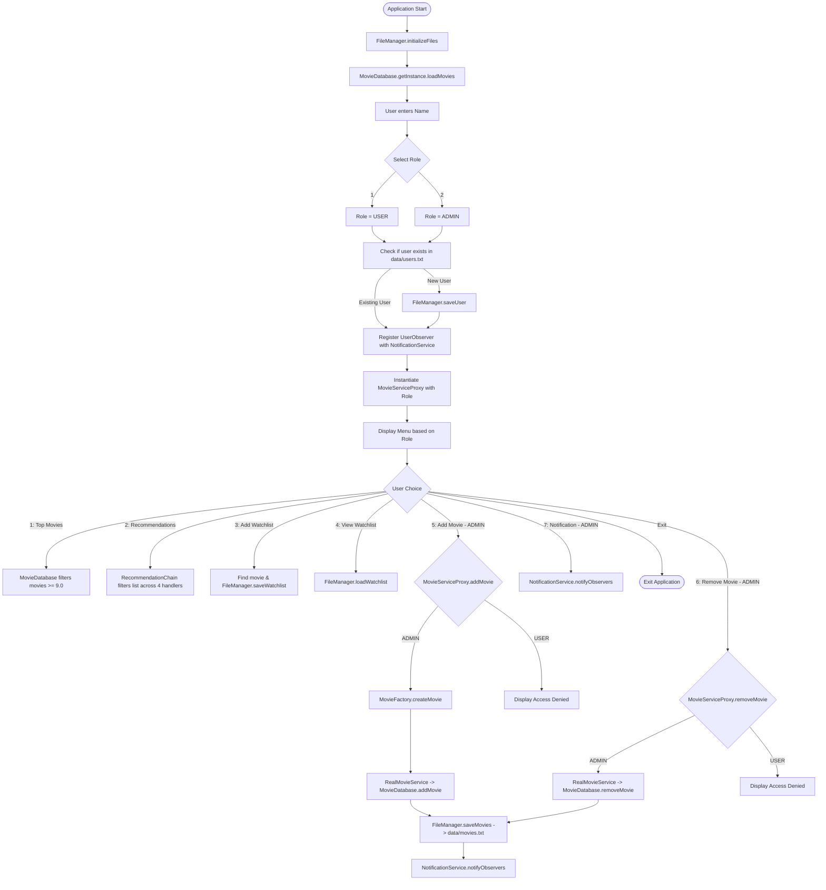

<<<<<<< HEAD
# 🎬 Movie & OTT Recommendation System (CinePattern)

[](https://www.java.com/)
[](https://en.wikipedia.org/wiki/Design_Patterns)
[](frontend/)
[-success?style=for-the-badge)](backend/data/)
[](https://github.com/sayyadrehan09/DP-Lab)

A full-stack, enterprise-grade **Movie & OTT Recommendation System** featuring a Java backend and a modern cinematic web interface. Built for the **Design Patterns Laboratory Assessment**, this system demonstrates how standard **Gang of Four (GoF)** design patterns decouple business logic, enforce role-based access control, manage data flow, and implement flexible filtering pipelines.
=======
# Movie & OTT Recommendation System (DP-Lab)

[](https://www.java.com/)
[](https://en.wikipedia.org/wiki/Design_Patterns)
[](https://docs.oracle.com/javase/8/docs/api/java/io/package-summary.html)
[](https://github.com/sayyadrehan09/DP-Lab)

A console-based movie discovery and streaming recommendation system developed in core Java for an academic Design Patterns laboratory assessment. The application allows users to explore streaming titles, receive multi-criteria recommendations across platforms (Netflix, Prime Video, Disney+), and curate personal watchlists, while providing administrators with catalog management tools backed by classic Gang of Four (GoF) design patterns.
>>>>>>> 63bb7e7 (Update readme)

---

## Table of Contents

<<<<<<< HEAD
- [Overview](#-overview)
- [Directory & Folder Structure](#-directory--folder-structure)
- [Design Patterns Implemented](#-design-patterns-implemented)
  - [1. Singleton Pattern](#1-singleton-pattern)
  - [2. Factory Method Pattern](#2-factory-method-pattern)
  - [3. Protection Proxy Pattern](#3-protection-proxy-pattern)
  - [4. Observer Pattern](#4-observer-pattern)
  - [5. Chain of Responsibility Pattern](#5-chain-of-responsibility-pattern)
- [Design Patterns Summary Table](#-design-patterns-summary-table)
- [Features & Role-Based Capabilities](#-features--role-based-capabilities)
- [REST API Endpoints Reference](#-rest-api-endpoints-reference)
- [Data Storage Schema](#-data-storage-schema)
- [How to Run](#-how-to-run)
  - [Option A: One-Click Quick Launch (Recommended)](#option-a-one-click-quick-launch-recommended)
  - [Option B: Command Line (Java REST Server + Web UI)](#option-b-command-line-java-rest-server--web-ui)
  - [Option C: Original Terminal CLI](#option-c-original-terminal-cli)
- [Author](#-author)
=======
- [Features](#features)
  - [Regular User](#regular-user)
  - [Admin](#admin)
- [Design Patterns Implemented](#design-patterns-implemented)
  - [1. Singleton Pattern](#1-singleton-pattern)
  - [2. Factory Method Pattern](#2-factory-method-pattern)
  - [3. Proxy Pattern](#3-proxy-pattern)
  - [4. Observer Pattern](#4-observer-pattern)
  - [5. Chain of Responsibility Pattern](#5-chain-of-responsibility-pattern)
- [Design Patterns Summary](#design-patterns-summary)
- [Architecture and Workflow](#architecture-and-workflow)
- [Directory Structure](#directory-structure)
- [Data Storage Schema](#data-storage-schema)
- [Getting Started](#getting-started)
  - [Prerequisites](#prerequisites)
  - [Running via IDE](#running-via-ide)
  - [Running via Command Line](#running-via-command-line)
  - [Important Execution Note](#important-execution-note)
- [Sample Console Session](#sample-console-session)
- [Author](#author)
>>>>>>> 63bb7e7 (Update readme)

---

## Features

### Regular User
- **View Top 5 Movies**: Displays top-rated movies with a rating of 9.0 or higher, sorted in descending order.
- **Get Recommendations**: Filter catalog dynamically by genre, language, minimum rating, and streaming platform.
- **Add to Watchlist**: Look up a movie by title and persist it to a user-specific watchlist file.
- **View Watchlist**: Retrieve and display all saved movie titles for the logged-in user.
- **Real-Time Notifications**: Receive console alerts when an admin adds new movies or sends announcements.

### Admin
- **View Top 5 Movies**: Access the same ranked top-movie list available to regular users.
- **Get Recommendations**: Run multi-criteria catalog searches.
- **Manage Watchlist**: Add and view personal watchlist items.
- **Add Movie**: Insert a new movie into the catalog (authorized through a protection proxy, instantiated via a factory, persisted to disk, and broadcast to all observers).
- **Remove Movie**: Delete an existing movie by its unique identifier (authorized through a protection proxy and updated on disk).
- **Broadcast Notifications**: Manually trigger system-wide notification messages to active session observers.

---

<<<<<<< HEAD
## 📁 Directory & Folder Structure

```plaintext
DP-Lab/
├── backend/                        # Java Core Engine & REST API
│   ├── data/                       # Text-file persistence storage
│   │   ├── movies.txt              # Pipe-delimited movie catalog dataset
│   │   ├── users.txt               # Stored usernames and assigned roles
│   │   └── watchlist.txt           # User-specific saved movie watchlists
│   ├── FileManager.java            # File I/O persistence handler (load/save/sync)
│   ├── Main.java                   # Console UI and terminal CLI controller
│   ├── Movie.java                  # Domain entity representing a movie
│   ├── MovieDatabase.java          # [Singleton Pattern] In-memory repository manager
│   ├── MovieFactory.java           # [Factory Method Pattern] Instantiation & parsing utility
│   ├── ObserverPattern.java        # [Observer Pattern] Subject & subscriber notification system
│   ├── ProxyPattern.java           # [Protection Proxy Pattern] Role-based access control
│   ├── RecommendationChain.java    # [Chain of Resp.] Filtering pipeline
│   ├── Server.java                 # Built-in HTTP REST API & Static File Server
│   └── run-backend.bat             # Backend launch script
│
├── frontend/                       # Modern Cinematic Web Interface
│   ├── index.html                  # Responsive SPA with 6 views
│   ├── style.css                   # Premium Dark OTT theme (Netflix / Prime Video style)
│   └── app.js                      # API client, live trace & pattern visualizer
│
├── .gitignore                      # Git ignore rules for Java & Node
├── README.md                       # Comprehensive documentation
└── start.bat                       # One-click launcher (Compiles, boots server & opens browser)
```

---

## 🛠 Design Patterns Implemented

The application cleanly implements **5 classic GoF Design Patterns** across Creational, Structural, and Behavioral categories:

```
┌────────────────────────────────────────────────────────────────────────┐
│                        GOF DESIGN PATTERNS                             │
├─────────────────┬──────────────────────┬───────────────────────────────┤
│   Creational    │      Structural      │          Behavioral           │
├─────────────────┼──────────────────────┼───────────────────────────────┤
│ • Singleton     │ • Protection Proxy   │ • Observer Pattern            │
│ • Factory Method│                      │ • Chain of Responsibility     │
└─────────────────┴──────────────────────┴───────────────────────────────┘
```

### 1. Singleton Pattern
* **File:** [`backend/MovieDatabase.java`](file:///f:/00.%20College/5th%20Semester/9%20Design%20Pattern/Lab%20Assesment/DP-Lab/backend/MovieDatabase.java)
* **Type:** Creational
* **Role:** Guarantees that only one global instance of the movie database exists in memory throughout the application lifecycle.
* **Implementation:**
  - Private constructor prevents direct instantiation (`new MovieDatabase()`).
  - Static accessor `getInstance()` provides a synchronized, single access point.
  - Manages the in-memory cache of movies and coordinates with `FileManager`.

=======
## Design Patterns Implemented

### 1. Singleton Pattern
- **Category**: Creational
- **Source File**: [./MovieDatabase.java](./MovieDatabase.java)
- **Why Used**: Ensures a single centralized in-memory store for movie entities across the entire application lifetime, avoiding inconsistent catalog states between services.
- **Code Snippet**:
>>>>>>> 63bb7e7 (Update readme)
```java
public class MovieDatabase {
    private static MovieDatabase instance;
    private List<Movie> movies;

    private MovieDatabase() {
        movies = new ArrayList<>();
    }

    public static synchronized MovieDatabase getInstance() {
        if (instance == null) {
            instance = new MovieDatabase();
        }
        return instance;
    }
```

---

### 2. Factory Method Pattern
<<<<<<< HEAD
* **File:** [`backend/MovieFactory.java`](file:///f:/00.%20College/5th%20Semester/9%20Design%20Pattern/Lab%20Assesment/DP-Lab/backend/MovieFactory.java)
* **Type:** Creational
* **Role:** Encapsulates the instantiation logic for `Movie` objects and decouples raw file string parsing from the domain model.
* **Implementation:**
  - `createMovie(...)`: Instantiates a `Movie` from validated user/web input.
  - `createMovieFromFile(String data)`: Parses delimited pipe-separated text (`id|title|genre|...`) from `backend/data/movies.txt` into strongly-typed `Movie` domain objects.

=======
- **Category**: Creational
- **Source File**: [./MovieFactory.java](./MovieFactory.java)
- **Why Used**: Encapsulates the instantiation logic of `Movie` objects, separating interactive console parameter parsing and pipe-delimited file deserialization from the `Movie` model.
- **Code Snippet**:
>>>>>>> 63bb7e7 (Update readme)
```java
public class MovieFactory {
    public static Movie createMovie(int id, String title, String genre, String language, double rating, int year, String platform) {
        return new Movie(id, title, genre, language, rating, year, platform);
    }

    public static Movie createMovieFromFile(String data) {
        String[] parts = data.split("\\|", -1);
        if (parts.length != 7) return null;
        return new Movie(Integer.parseInt(parts[0]), parts[1], parts[2], parts[3], Double.parseDouble(parts[4]), Integer.parseInt(parts[5]), parts[6]);
    }
}
```

---

<<<<<<< HEAD
### 3. Protection Proxy Pattern
* **File:** [`backend/ProxyPattern.java`](file:///f:/00.%20College/5th%20Semester/9%20Design%20Pattern/Lab%20Assesment/DP-Lab/backend/ProxyPattern.java)
* **Type:** Structural
* **Role:** Restricts access to sensitive catalog operations based on the active session role (`USER` vs `ADMIN`).
* **Implementation:**
  - **Subject Interface:** `MovieService` defines `addMovie()`, `removeMovie()`, and `viewMovies()`.
  - **Real Subject:** `RealMovieService` communicates with `MovieDatabase` to execute operations.
  - **Proxy:** `MovieServiceProxy` intercepts calls. It permits read actions to all users, but blocks write/delete attempts by non-administrators with `403 Forbidden` / `Access Denied! Only ADMIN can add/remove movies.`.

=======
### 3. Proxy Pattern
- **Category**: Structural
- **Source File**: [./ProxyPattern.java](./ProxyPattern.java)
- **Why Used**: Implements a Protection Proxy (`MovieServiceProxy`) that inspects the current user's role before forwarding write/delete operations to `RealMovieService`.
- **Diagram**:
```mermaid
classDiagram
    direction LR
    class MovieService {
        <<interface>>
        +addMovie(Movie)
        +removeMovie(int)
        +viewMovies()
    }
    class RealMovieService {
        +addMovie(Movie)
        +removeMovie(int)
        +viewMovies()
    }
    class MovieServiceProxy {
        -String role
        -RealMovieService realService
        +addMovie(Movie)
        +removeMovie(int)
        +viewMovies()
    }
    MovieService <|.. RealMovieService : implements
    MovieService <|.. MovieServiceProxy : implements
    MovieServiceProxy --> RealMovieService : forwards if role is ADMIN
>>>>>>> 63bb7e7 (Update readme)
```
- **Code Snippet**:
```java
class MovieServiceProxy implements MovieService {
    private RealMovieService realService = new RealMovieService();
    private String role;
    public MovieServiceProxy(String role) { this.role = role; }
    public void addMovie(Movie movie) {
        if (role.equalsIgnoreCase("ADMIN")) realService.addMovie(movie);
        else System.out.println("\nAccess Denied! Only ADMIN can add movies.");
    }
    public void removeMovie(int id) {
        if (role.equalsIgnoreCase("ADMIN")) realService.removeMovie(id);
        else System.out.println("\nAccess Denied! Only ADMIN can remove movies.");
    }
    public void viewMovies() { realService.viewMovies(); }
}
```

---

### 4. Observer Pattern
<<<<<<< HEAD
* **File:** [`backend/ObserverPattern.java`](file:///f:/00.%20College/5th%20Semester/9%20Design%20Pattern/Lab%20Assesment/DP-Lab/backend/ObserverPattern.java)
* **Type:** Behavioral
* **Role:** Establishes a one-to-many publish-subscribe communication channel between system events and registered users.
* **Implementation:**
  - **Subject Interface:** `Subject` (`addObserver()`, `removeObserver()`, `notifyObservers()`).
  - **Concrete Subject:** `NotificationService` maintains active subscribers and notification history.
  - **Observer Interface:** `Observer` (`update(String message)`).
  - **Concrete Observer:** `UserObserver` logs notifications to user terminals and pushes real-time updates to the web interface.

=======
- **Category**: Behavioral
- **Source File**: [./ObserverPattern.java](./ObserverPattern.java)
- **Why Used**: Provides a loosely coupled publisher-subscriber mechanism where `NotificationService` (Subject) informs all active `UserObserver` instances when catalog changes or administrative broadcasts occur.
- **Diagram**:
```mermaid
classDiagram
    direction LR
    class Subject {
        <<interface>>
        +addObserver(Observer)
        +removeObserver(Observer)
        +notifyObservers(String)
    }
    class NotificationService {
        -List~Observer~ observers
        +addObserver(Observer)
        +removeObserver(Observer)
        +notifyObservers(String)
    }
    class Observer {
        <<interface>>
        +update(String)
    }
    class UserObserver {
        -String name
        +update(String)
    }
    Subject <|.. NotificationService : implements
    Observer <|.. UserObserver : implements
    NotificationService o--> Observer : notifies
>>>>>>> 63bb7e7 (Update readme)
```
- **Code Snippet**:
```java
interface Observer { void update(String message); }
interface Subject {
    void addObserver(Observer observer);
    void removeObserver(Observer observer);
    void notifyObservers(String message);
}

class UserObserver implements Observer {
    private String name;
    public UserObserver(String name) { this.name = name; }
    public void update(String message) { System.out.println("\nNotification for " + name + ": " + message); }
}

class NotificationService implements Subject {
    private List<Observer> observers = new ArrayList<>();
    public void addObserver(Observer observer) { observers.add(observer); }
    public void removeObserver(Observer observer) { observers.remove(observer); }
    public void notifyObservers(String message) { for (Observer observer : observers) observer.update(message); }
}
```

---

### 5. Chain of Responsibility Pattern
<<<<<<< HEAD
* **File:** [`backend/RecommendationChain.java`](file:///f:/00.%20College/5th%20Semester/9%20Design%20Pattern/Lab%20Assesment/DP-Lab/backend/RecommendationChain.java)
* **Type:** Behavioral
* **Role:** Chains multiple sequential filters together to process movie recommendations dynamically without hard-coding complex multi-branch conditional logic.
* **Implementation:**
  - **Handler Base:** `RecommendationHandler` holds a reference to `next` and defines the abstract `filter()` contract.
  - **Concrete Handlers:**
    1. `GenreHandler` (Matches genre or passes through if `"Any"`)
    2. `LanguageHandler` (Matches language or passes through if `"Any"`)
    3. `RatingHandler` (Filters movies meeting or exceeding minimum rating threshold)
    4. `PlatformHandler` (Matches OTT streaming provider or passes through if `"Any"`)
  - **Chain Coordinator:** `RecommendationChain` wires `Genre -> Language -> Rating -> Platform` and returns the final filtered list, including a step-by-step candidate trace for the web visualizer.

=======
- **Category**: Behavioral
- **Source File**: [./RecommendationChain.java](./RecommendationChain.java)
- **Why Used**: Decouples multi-attribute search criteria into discrete, interchangeable filter handlers (`GenreHandler`, `LanguageHandler`, `RatingHandler`, `PlatformHandler`) linked in a processing chain.
- **Diagram**:
```mermaid
flowchart LR
    In([List of Movies]) --> G[GenreHandler]
    G -->|Filtered by genre or 'Any'| L[LanguageHandler]
    L -->|Filtered by language or 'Any'| R[RatingHandler]
    R -->|Filtered by minimum rating| P[PlatformHandler]
    P -->|Filtered by platform or 'Any'| Out([Recommended Movies])
>>>>>>> 63bb7e7 (Update readme)
```
- **Code Snippet**:
```java
class RecommendationChain {
    private RecommendationHandler chain;
    public RecommendationChain() {
        RecommendationHandler genre = new GenreHandler();
        RecommendationHandler language = new LanguageHandler();
        RecommendationHandler rating = new RatingHandler();
        RecommendationHandler platform = new PlatformHandler();
        genre.setNext(language);
        language.setNext(rating);
        rating.setNext(platform);
        chain = genre;
    }
    public List<Movie> recommend(List<Movie> movies, String genre, String language, double rating, String platform) {
        return chain.filter(movies, genre, language, rating, platform);
    }
}
```

---

## Design Patterns Summary

| Pattern | Category | File | Key Classes | Purpose |
| :--- | :--- | :--- | :--- | :--- |
<<<<<<< HEAD
| **Singleton** | Creational | [`backend/MovieDatabase.java`](file:///f:/00.%20College/5th%20Semester/9%20Design%20Pattern/Lab%20Assesment/DP-Lab/backend/MovieDatabase.java) | `MovieDatabase` | Centralized, synchronized movie data management in memory. |
| **Factory Method** | Creational | [`backend/MovieFactory.java`](file:///f:/00.%20College/5th%20Semester/9%20Design%20Pattern/Lab%20Assesment/DP-Lab/backend/MovieFactory.java) | `MovieFactory` | Encapsulates movie object creation and file record parsing. |
| **Proxy** | Structural | [`backend/ProxyPattern.java`](file:///f:/00.%20College/5th%20Semester/9%20Design%20Pattern/Lab%20Assesment/DP-Lab/backend/ProxyPattern.java) | `MovieService`, `RealMovieService`, `MovieServiceProxy` | Protection proxy enforcing role-based access control (Admin vs User). |
| **Observer** | Behavioral | [`backend/ObserverPattern.java`](file:///f:/00.%20College/5th%20Semester/9%20Design%20Pattern/Lab%20Assesment/DP-Lab/backend/ObserverPattern.java) | `Subject`, `Observer`, `NotificationService`, `UserObserver` | Notifies users when movies are added or broadcasts are triggered. |
| **Chain of Responsibility** | Behavioral | [`backend/RecommendationChain.java`](file:///f:/00.%20College/5th%20Semester/9%20Design%20Pattern/Lab%20Assesment/DP-Lab/backend/RecommendationChain.java) | `RecommendationHandler`, `GenreHandler`, `LanguageHandler`, `RatingHandler`, `PlatformHandler` | Sequential multi-criteria recommendation filtering pipeline. |
=======
| **Singleton** | Creational | [./MovieDatabase.java](./MovieDatabase.java) | `MovieDatabase` | Provides a single in-memory movie repository with global access. |
| **Factory Method** | Creational | [./MovieFactory.java](./MovieFactory.java) | `MovieFactory` | Centralizes creation of `Movie` entities from parameters and file records. |
| **Proxy** | Structural | [./ProxyPattern.java](./ProxyPattern.java) | `MovieService`, `RealMovieService`, `MovieServiceProxy` | Enforces role-based access control for movie additions and deletions. |
| **Observer** | Behavioral | [./ObserverPattern.java](./ObserverPattern.java) | `Subject`, `NotificationService`, `Observer`, `UserObserver` | Broadcasts new movie alerts and admin notifications to registered users. |
| **Chain of Responsibility** | Behavioral | [./RecommendationChain.java](./RecommendationChain.java) | `RecommendationHandler`, `GenreHandler`, `LanguageHandler`, `RatingHandler`, `PlatformHandler`, `RecommendationChain` | Sequentially filters movies across multiple user-defined criteria. |
>>>>>>> 63bb7e7 (Update readme)

---

## Architecture and Workflow

<<<<<<< HEAD
### 👤 Regular User Features
1. **Interactive Movie Catalog:** Browse, search, and filter in-memory titles in real time.
2. **View Top 5 Movies:** Displays the top-ranked masterpieces with ratings $\ge 9.0$.
3. **Chain of Responsibility Recommender:** Custom criteria pipeline with live node-by-node pass count animation.
4. **Personal Watchlist:** Bookmark movies to user's persistent watchlist with add/remove support.
5. **Real-time Notifications:** Bell notification drawer fed by the Observer Pattern.

### 🛡️ Admin Privileges
Includes all user features plus:
1. **Add Movie:** Adds new titles via `MovieFactory` and validated by `MovieServiceProxy`, broadcasting alert to observers.
2. **Remove Movie:** Deletes movies by ID from the catalog via `MovieServiceProxy`.
3. **Broadcast System Notification:** Triggers broadcast messages to all active user observers.

---

## 🌐 REST API Endpoints Reference

| Method | Endpoint | Description |
|---|---|---|
| `GET` | `/api/movies` | Fetch all movies or filter by `?search=`, `?genre=`, `?platform=` |
| `GET` | `/api/top-movies` | Fetch top-rated movies (Rating $\ge$ 9.0) sorted descending |
| `POST` | `/api/recommend` | Runs the 4-stage Chain of Responsibility pipeline with live stage trace |
| `GET` | `/api/watchlist?user={name}` | Retrieves saved watchlist for a user |
| `POST` | `/api/watchlist` | Adds a movie to user's watchlist |
| `DELETE` | `/api/watchlist?user={name}&movieId={id}` | Removes a movie from user's watchlist |
| `POST` | `/api/movies` | Adds a movie via `MovieFactory` (protected by `MovieServiceProxy`) |
| `DELETE` | `/api/movies?id={id}` | Removes a movie (protected by `MovieServiceProxy`) |
| `POST` | `/api/login` | Log in as USER or ADMIN and register as an Observer |
| `GET` | `/api/notifications` | Get Observer pattern notification feed |
| `POST` | `/api/notify` | Broadcast message to all observers (Admin only) |
| `GET` | `/api/design-patterns` | Live metrics & status of all 5 patterns in the JVM |
=======
The following flowchart illustrates the complete user lifecycle from startup to pattern execution and file persistence:



---

## Directory Structure

```plaintext
DP-Lab/
├── data/
│   ├── movies.txt              # Pipe-delimited database file containing movie records
│   ├── users.txt               # Text file tracking registered user accounts and their roles
│   └── watchlist.txt           # File storing user-specific saved watchlist entries
├── FileManager.java            # Utility class handling file reading, writing, and initialization
├── Main.java                   # Console UI controller handling input loops and menu dispatching
├── Movie.java                  # Domain entity representing movie attributes and print formatting
├── MovieDatabase.java          # Singleton class managing the in-memory movie list and sync
├── MovieFactory.java           # Factory class creating Movie instances from input or text records
├── ObserverPattern.java        # Observer and Subject interfaces and concrete notification classes
├── ProxyPattern.java           # MovieService interface, real implementation, and protection proxy
├── RecommendationChain.java    # Abstract handler and concrete filters for the recommendation pipeline
├── Lab Assesment/              # Directory holding compiled .class bytecode files
├── Lab Assesment.iml           # IntelliJ IDEA project module configuration file
└── README.md                   # Project documentation
```
>>>>>>> 63bb7e7 (Update readme)

---

## Data Storage Schema

<<<<<<< HEAD
The application persists data inside `backend/data/` using pipe-separated values (`|`):
=======
All application data is persisted inside the `data/` directory using flat text files with pipe (`|`) delimiters.
>>>>>>> 63bb7e7 (Update readme)

### 1. `data/movies.txt`
Stores the movie catalog. Each line represents a single movie record.
- **Format**: `id|title|genre|language|rating|year|platform`
- **Example**:
  ```plaintext
  1|The Shawshank Redemption|Drama|English|9.3|1994|Netflix
  ```

### 2. `data/users.txt`
Stores registered user sessions and their assigned roles.
- **Format**: `username|role`
- **Example**:
  ```plaintext
  Aryan|USER
  ```

### 3. `data/watchlist.txt`
Stores movie entries bookmarked by users.
- **Format**: `username|id|title|genre|language|rating|year|platform`
- **Example**:
  ```plaintext
  Aryan|10|Joker|Drama|English|8.4|2019|Prime Video
  ```

---

<<<<<<< HEAD
## 🚀 How to Run

### Option A: One-Click Quick Launch (Recommended)
Double-click `start.bat` in the root folder.
This will:
1. Compile all Java backend sources.
2. Launch the HTTP REST API server on `http://localhost:8080`.
3. Automatically launch your default web browser to the interface.
=======
## Getting Started

### Prerequisites
- **Java Development Kit (JDK)**: Version 8 or higher.
- A terminal (PowerShell, Command Prompt, or Bash) or a Java IDE (such as IntelliJ IDEA or Eclipse).
>>>>>>> 63bb7e7 (Update readme)

### Running via IDE
1. Open the project folder in **IntelliJ IDEA** or your preferred Java IDE.
2. Verify that a valid Project SDK (JDK 8+) is configured under project settings.
3. Locate [./Main.java](./Main.java).
4. Run `Main.main()` directly via the IDE run button or shortcut (`Shift + F10`).

<<<<<<< HEAD
### Option B: Command Line (Java REST Server + Web UI)
1. Open PowerShell or Command Prompt in the repository folder:
   ```powershell
   cd backend
   javac -d . *.java
   java Server
   ```
2. Open `http://localhost:8080` in your browser.

---

### Option C: Original Terminal CLI
If you or an evaluator want to run the terminal-based interactive menu:
```powershell
cd backend
javac -d . *.java
java Main
=======
### Running via Command Line
1. Open your terminal and navigate to the project directory:
   ```bash
   cd DP-Lab
   ```
2. Compile all Java source files:
   ```bash
   javac *.java
   ```
3. Run the compiled application:
   ```bash
   java Main
   ```

### Important Execution Note
> **Directory Context**: The `FileManager` class uses hardcoded relative file paths (`data/movies.txt`, `data/users.txt`, `data/watchlist.txt`). Always launch the application with the working directory set to the folder that contains the `data/` subdirectory, otherwise file loading and initialization will fail.

---

## Sample Console Session

```plaintext
==============================================
       MOVIE & OTT RECOMMENDATION SYSTEM
==============================================

Enter your name: Alice

Select Role:
1. User
2. Admin
1

============== MENU ==============
1. View Top 5 Movies
2. Get Recommendations
3. Add Movie to Watchlist
4. View Watchlist
5. Exit
Enter choice: 2

========== MOVIE RECOMMENDATION ==========

Select Genre:
1. Action
2. Comedy
3. Sci-Fi
4. Drama
5. Thriller
6. Any
Enter choice: 3

Select Language:
1. English
2. Hindi
3. Any
Enter choice: 1

Enter minimum rating (0-10): 9.0

Select OTT Platform:
1. Netflix
2. Prime Video
3. Disney+
4. Any
Enter choice: 1

==============================================
           RECOMMENDED MOVIES
==============================================

ID       : 5
Title    : Inception
Genre    : Sci-Fi
Language : English
Rating   : 9.0
Year     : 2010
Platform : Netflix
----------------------------------------
Total Recommendations: 1

============== MENU ==============
1. View Top 5 Movies
2. Get Recommendations
3. Add Movie to Watchlist
4. View Watchlist
5. Exit
Enter choice: 5

Thank you for using the system.
>>>>>>> 63bb7e7 (Update readme)
```

---

## Author

<<<<<<< HEAD
Developed by **[Rehan Sayyad](https://github.com/sayyadrehan09)** for the **Design Patterns (DP) Laboratory Assessment**.
=======
Developed by **[Rehan Sayyad](https://github.com/sayyadrehan09)** for the **Design Patterns Laboratory Assessment**.
>>>>>>> 63bb7e7 (Update readme)
